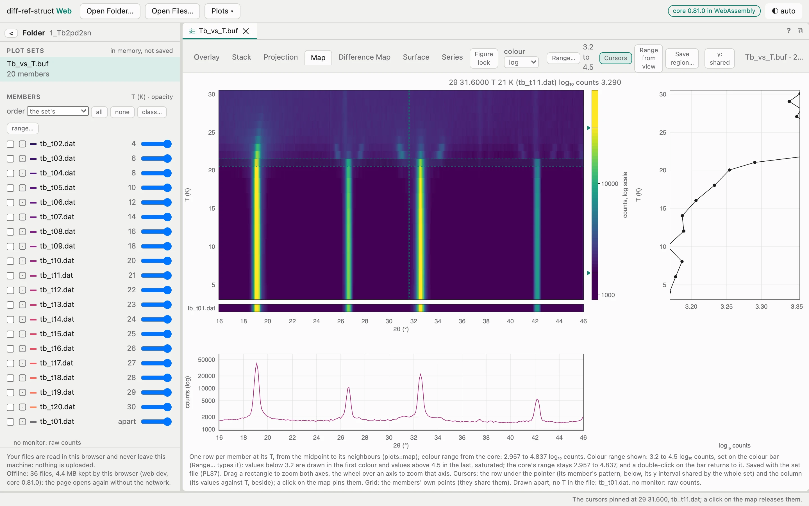
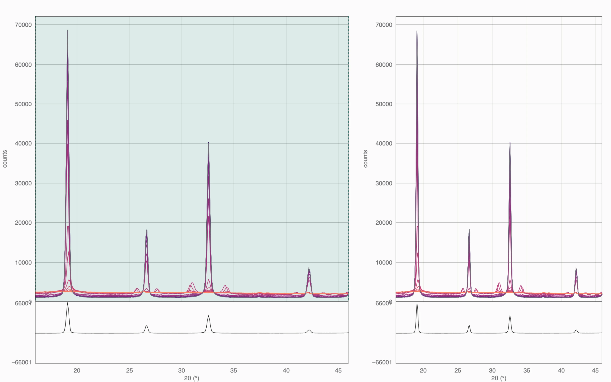
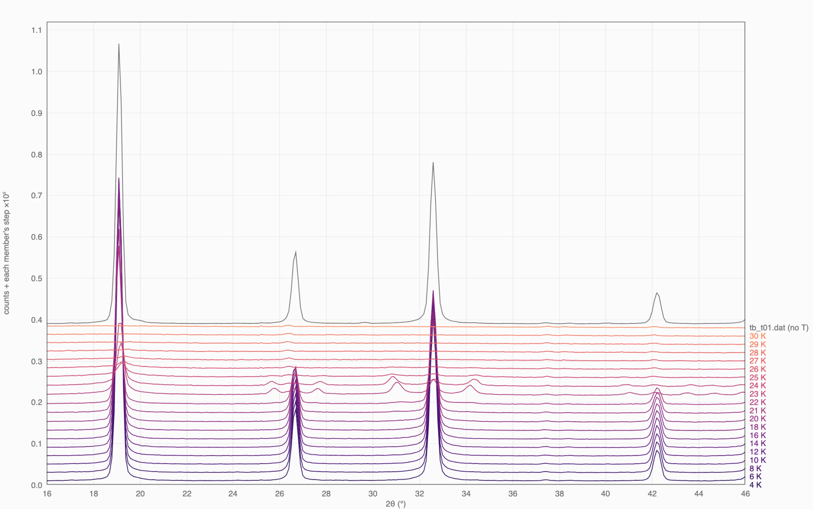
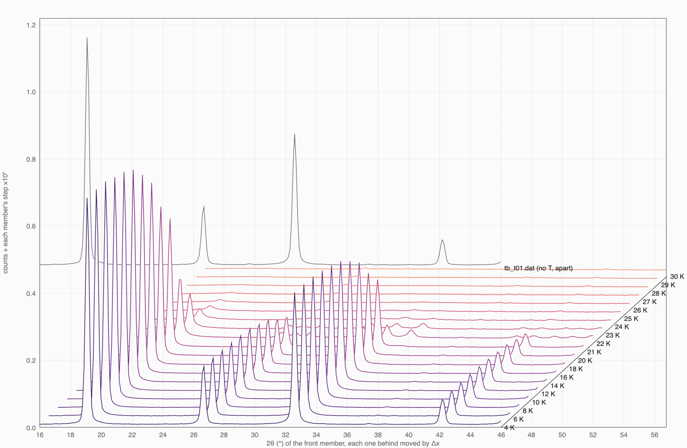
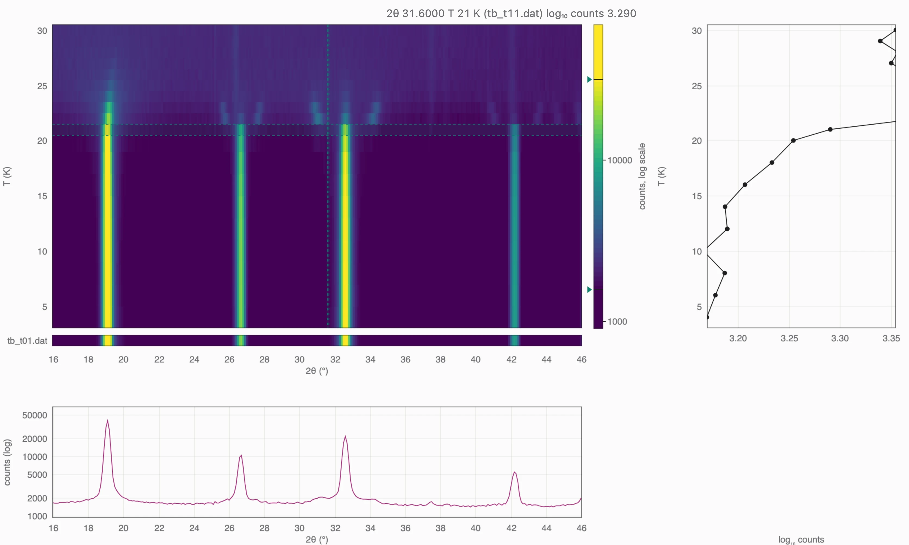
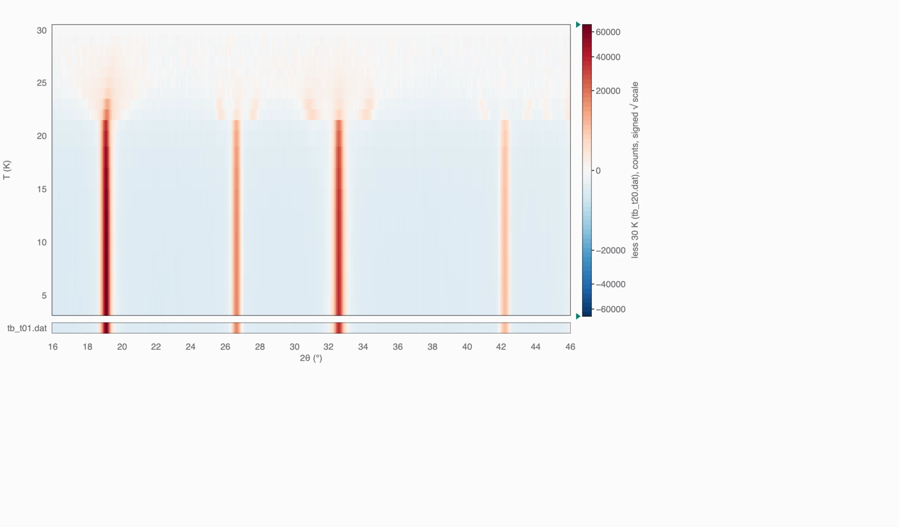
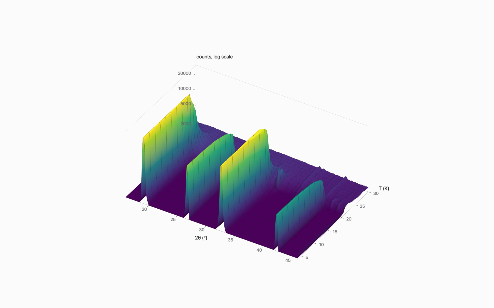
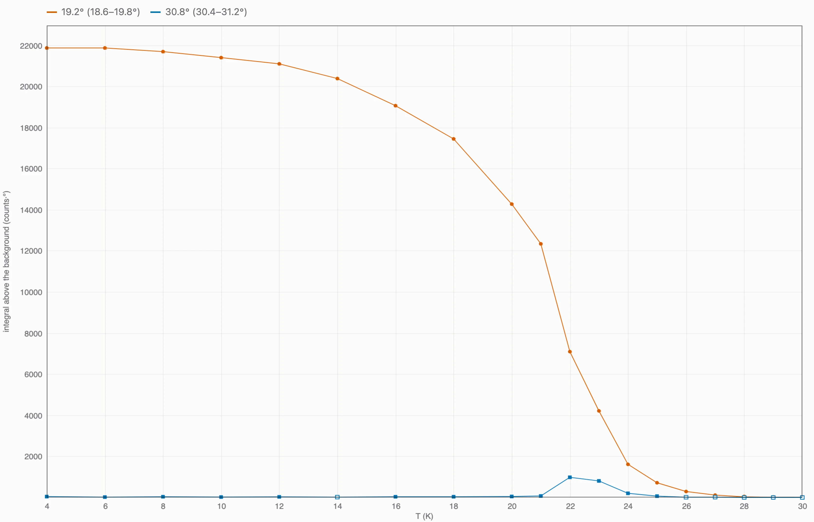

```{=html}
<section class="mission">
  <div class="wrap mission-grid">
    <div>
      <h1>A whole series of powder patterns as one picture: <strong>maps, stacks and growth curves, in your browser, with nothing uploaded.</strong></h1>
      <p class="who">Open a folder of diffraction patterns (a temperature ramp, an in-situ run at a synchrotron, a series from a laboratory diffractometer) and see them at once: overlaid, stacked, projected, as a colour map of intensity against 2&theta; and temperature or time, as differences from a reference, as growth curves of chosen peaks. The diff-ref-struct core computes every number, compiled to WebAssembly and run in your browser. Your files never leave your machine.</p>
      <div class="cta-row">
        <a class="cta" href="https://jmigartua.github.io/diff-ref-struct-web/">Open the app</a>
        <a class="cta quiet" href="start/index.html">Start in five minutes</a>
        <span class="note">No account, no installation; Chrome, Edge, Firefox, Safari.</span>
      </div>
      <p class="quicklinks"><a href="https://jmigartua.github.io/diff-ref-struct-web/">Try the example in the app</a><span class="sep">&middot;</span><a href="manual/index.html">The manual</a><span class="sep">&middot;</span><a href="downloads/user-manual.pdf">PDF</a><span class="sep">&middot;</span><a href="manual/quick-reference/index.html">Quick reference</a><span class="sep">&middot;</span><a href="recipes/index.html">Recipes</a><span class="sep">&middot;</span><a href="how/index.html">How it works</a></p>
    </div>
    <div>
      <div class="net-stats net-stats-grid">
        <div class="net-stat"><div class="v">0</div><div class="k">bytes of your data uploaded: there is no server</div></div>
        <div class="net-stat"><div class="v">7</div><div class="k">views of a set: overlay, stack, projection, map, difference map, surface, series</div></div>
        <div class="net-stat"><div class="v">23</div><div class="k">text data formats read: FullProf, GSAS, Topas, ILL, PSI, PANalytical, Rigaku, Fit2D/pyFAI, CIF, CSV…</div></div>
        <div class="net-stat"><div class="v">4.4&nbsp;MB</div><div class="k">kept by your browser: the page then opens offline</div></div>
      </div>
    </div>
  </div>
</section>

<section class="home-section">
  <div class="wrap">
```



```{=html}
    <figure class="shot"><picture><source srcset="assets/figures/app-map-dark.webp" media="(prefers-color-scheme: dark)"></picture><figcaption>Twenty neutron patterns of Tb<sub>2</sub>Pd<sub>2</sub>Sn from 4 to 30&nbsp;K (the WinPLOTR tutorial of the FullProf Suite) on the Map: one row per temperature, colour on a log scale clipped to 3.2&ndash;4.5 on the colour bar, the cursors pinned at 2&theta; 31.6&deg;: the pattern of that row below, the intensity at that angle against temperature at the right. Taken from the app itself.</figcaption></figure>
  </div>
</section>

<section class="featured-band">
  <div class="wrap featured-grid">
    <div>
      <div class="featured-kicker">From a folder to a map</div>
      <h2 class="featured-title">Three steps<span class="featured-sub">The core reads the folder and proposes the sets it makes</span></h2>
      <p class="featured-body"><b>Open the folder</b> (or drop it on the page): the core describes every file, its format and what it holds. <b>Choose a set</b> among those the core proposes (one scan per temperature, each hold at constant temperature against time, the whole run against time), or pick the files yourself. <b>Read the map</b>: clip the colour range on its bar to bring up weak peaks, zoom, pin the cursors on a peak to see its intensity through the series, name the regions worth coming back to. The view is kept in the page's address: a reload or a link brings it back.</p>
      <p class="featured-links"><a href="start/index.html">Start in five minutes</a><span class="sep">&middot;</span><a href="recipes/ramp/index.html">Recipe: a ramp</a><span class="sep">&middot;</span><a href="recipes/hold/index.html">Recipe: a hold</a></p>
    </div>
    <div class="featured-when">
      <div class="d">Try it on public data</div>
      <div class="l">the Tb<sub>2</sub>Pd<sub>2</sub>Sn patterns of FullProf's WinPLOTR tutorial: 20 files, 19 placed by temperature</div>
      <div class="c">start/ &rarr; the example</div>
    </div>
  </div>
</section>

<section class="home-section" id="views">
  <div class="wrap">
    <div class="sec-head"><h2>Seven views of one set</h2><a class="more" href="manual/index.html">The manual &rarr;</a></div>
    <p class="sec-intro">A plot set is many patterns, each with its value of a variable: a temperature, a time, a value you type with its source. Every view takes the same set.</p>
    <div class="views">
      <div class="v"><picture><source srcset="assets/figures/view-overlay-dark.webp" media="(prefers-color-scheme: dark)"></picture><h3>Overlay</h3><p>Every pattern on the same axes, coloured along the series. Linked zoom adds a zoomed plot and a difference strip between two patterns.</p></div>
      <div class="v"><picture><source srcset="assets/figures/view-stack-dark.webp" media="(prefers-color-scheme: dark)"></picture><h3>Stack</h3><p>Each pattern raised by a step the core proposes, labelled with its temperature; steps in proportion to the variable if you like.</p></div>
      <div class="v"><picture><source srcset="assets/figures/view-projection-dark.webp" media="(prefers-color-scheme: dark)"></picture><h3>Projection</h3><p>Each pattern behind the one before, with an oblique axis for the variable, as WinPLOTR draws it.</p></div>
      <div class="v"><picture><source srcset="assets/figures/view-map-dark.webp" media="(prefers-color-scheme: dark)"></picture><h3>Map</h3><p>Intensity as colour, 2&theta; across, the variable up. The clip on the colour bar, cursors, zoom by axis, named regions.</p></div>
      <div class="v"><picture><source srcset="assets/figures/view-difference-dark.webp" media="(prefers-color-scheme: dark)"></picture><h3>Difference Map</h3><p>Every pattern less a reference pattern: what appears, what goes, what moves, in signed colour.</p></div>
      <div class="v"><picture><source srcset="assets/figures/view-surface-dark.webp" media="(prefers-color-scheme: dark)"></picture><h3>Surface</h3><p>The map, or the difference map, as a surface to turn and read; the colour clip limits its height.</p></div>
      <div class="v"><picture><source srcset="assets/figures/view-series-dark.webp" media="(prefers-color-scheme: dark)"></picture><h3>Series</h3><p>Windows of 2&theta; followed through the set: integral above the background, centroid, the strongest peak's position, height and width, with &sigma;.</p></div>
    </div>
  </div>
</section>

<section class="home-section tinted" id="trust">
  <div class="wrap">
    <div class="sec-head"><h2>Why the numbers can be trusted</h2><a class="more" href="how/index.html">How it works &rarr;</a></div>
    <div class="lines">
      <div class="line"><h3>One engine</h3><p>The page runs the diff-ref-struct core, the same Rust code as the Mac app and the command line <code>drs</code>, compiled to WebAssembly. There is no second implementation to drift from the first.</p></div>
      <div class="line"><h3>The page computes nothing</h3><p>Reading the files, finding temperatures and times, the map's grid and colour range, the steps, the differences, the integrals: all the core's. The page turns its answers into pixels and text.</p></div>
      <div class="line"><h3>Checked to the bit</h3><p>A test runs the browser's core on the Tb<sub>2</sub>Pd<sub>2</sub>Sn files given as a browser reads them, and requires its map to equal the command line's, number for number.</p></div>
    </div>
  </div>
</section>

<section class="home-section" id="privacy">
  <div class="wrap">
    <div class="sec-head"><h2>Your files stay on your machine</h2></div>
    <div class="lines">
      <div class="line"><h3>Read where they are</h3><p>The browser reads the folder you choose, file by file, when the core needs one. Nothing is uploaded: the page has no server to send to, and asks only to read.</p></div>
      <div class="line"><h3>Nothing else fetched</h3><p>The page loads its own files from its own address and nothing from elsewhere: no fonts, scripts or counters from other sites, no account, no tracking.</p></div>
      <div class="line"><h3>Offline after the first visit</h3><p>The browser keeps the page (36 files, 4.4&nbsp;MB, never a data file), so it opens at a beamline without network. Install it as an app if you like.</p></div>
    </div>
  </div>
</section>

<section class="home-section tinted" id="for">
  <div class="wrap">
    <div class="sec-head"><h2>Made for</h2><a class="more" href="recipes/index.html">Recipes &rarr;</a></div>
    <div class="shelf shelf-2">
      <div class="shelf-item"><div class="num">in situ</div><h3><a href="recipes/ramp/index.html">A temperature ramp</a></h3><p>When does a phase appear, a peak split, a reflection go? One row per temperature, the onset found on the map and checked on the patterns.</p></div>
      <div class="shelf-item"><div class="num">kinetics</div><h3><a href="recipes/hold/index.html">A hold at constant temperature</a></h3><p>Growth curves: the integral of a peak's window against time, with &sigma;, for every scan of the hold.</p></div>
      <div class="shelf-item"><div class="num">at the instrument</div><h3><a href="recipes/live/index.html">A run still being measured</a></h3><p>Live mode reads the folder again every few seconds; the map grows with every new scan.</p></div>
      <div class="shelf-item"><div class="num">with the team</div><h3><a href="recipes/share/index.html">A view to share</a></h3><p>The address keeps the set, view, zoom, colour range and region; a <code>.drv</code> keeps a whole set for the Mac app and the command line.</p></div>
    </div>
  </div>
</section>
```
