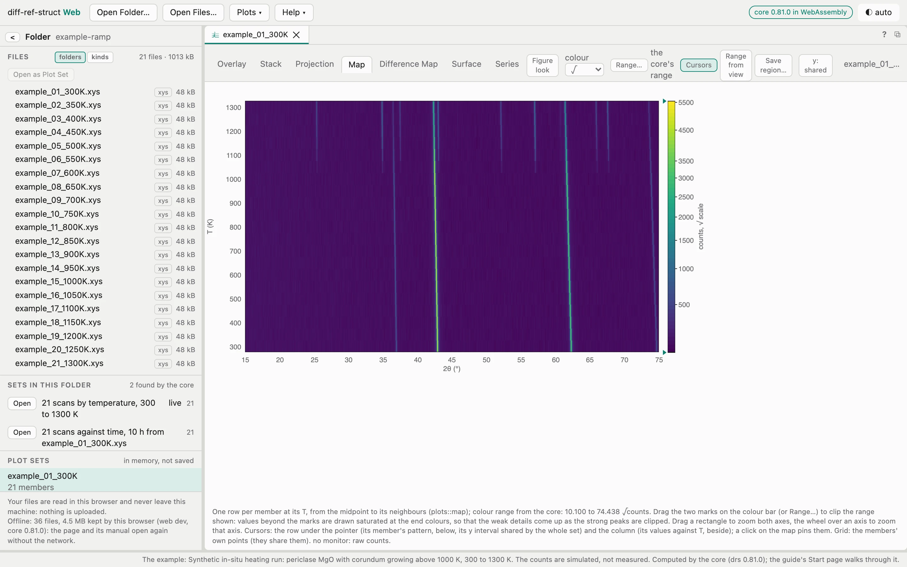
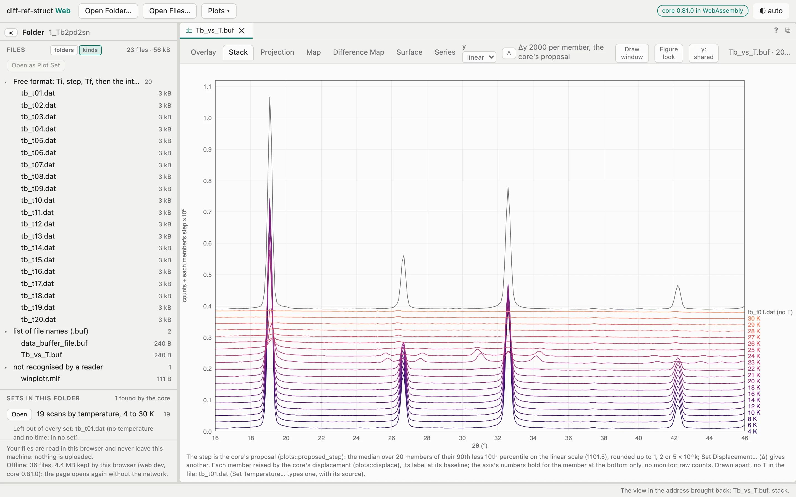

```{=html}
<article class="page-article">
<h1>Start in five minutes</h1>
<p class="sub">What your browser can do, then a folder of public data from opening to a map with its cursors pinned: every step is something you will do again on your own files.</p>

<h2>What this browser can do</h2>
<p>The page works in every current browser; a few things depend on which. This box asks your browser, here and now, what it supports. It measures nothing and sends nothing.</p>
<div class="check" id="check"><div class="head">Checking this browser…</div></div>

<h2>The quickest: the example in the app</h2>
<p>The app's start page has <b>Try the example</b>: a heating run the core computed itself, 21 scans of a periclase (MgO) sample from 300 to 1300&nbsp;K in which corundum (α-Al<sub>2</sub>O<sub>3</sub>) appears above about 1000&nbsp;K, laboratory X-rays (Cu Kα<sub>1</sub>), 2&theta; 15&ndash;75°. It opens as if its folder had been dropped: the core proposes <i>21 scans by temperature, 300 to 1300 K</i>, opens it and shows the Map. The counts are simulated, not measured, and free to use (CC BY 4.0). Read the map upwards: the periclase lines move to lower angles as the cell expands, and new lines start at 1050&nbsp;K.</p>
<figure class="shot"><picture><source srcset="../assets/figures/app-example-dark.webp" media="(prefers-color-scheme: dark)"></picture><figcaption>Try the example: the core's proposal opened on the Map, colour on a √ scale. The periclase lines bend to lower 2&theta; with temperature; corundum's begin above 1000&nbsp;K (clip the colour range to see them clearly).</figcaption></figure>

<h2>A measured example: twenty neutron patterns of Tb<sub>2</sub>Pd<sub>2</sub>Sn</h2>
<p>The FullProf Suite's WinPLOTR tutorial ships a folder of patterns of Tb<sub>2</sub>Pd<sub>2</sub>Sn measured at temperatures from 4 to 30&nbsp;K: twenty data files in FullProf's free format (2&theta; from 16 to 46&deg; in steps of 0.1&deg;, 301 points each, a temperature in each title), two WinPLOTR buffers that list them, and one file of another kind. It is small, public and has a clear story in temperature, which makes it the right first folder.</p>
<ol class="steps">
<li><b>Get the folder.</b> From the FullProf Suite's documentation page (<a href="https://www2017.ill.eu/sites/fullprof/documentation.html">ill.eu/sites/fullprof</a>), download the WinPLOTR tutorial and unzip it. The folder <code>1_Tb2pd2sn</code> is the one used here.</li>
<li><b>Open the app</b> at <a href="https://jmigartua.github.io/diff-ref-struct-web/">jmigartua.github.io/diff-ref-struct-web</a>. The chip at the right of the bar should read <i>core 0.81.0 in WebAssembly</i> (or later).</li>
<li><b>Open Folder…</b> and choose <code>1_Tb2pd2sn</code> (allow the browser to view the files), or drag the folder onto the page. The tree lists <b>23 files, 56&nbsp;kB</b>. Click <b>kinds</b> above the tree: the core says what each file is &mdash; 20 in <i>Free format: Ti, step, Tf, then the intensities</i>, 2 <i>list of file names (.buf)</i>, and <code>winplotr.mlf</code> <i>not recognised by a reader</i>.</li>
<li><b>Sets in this folder</b> shows the core's proposal: <i>19 scans by temperature, 4 to 30 K</i>, and under it <code>tb_t01.dat</code> left out (<i>no temperature and no time</i>). You could open it with <b>Open</b>; here, double-click <code>Tb_vs_T.buf</code> in the tree instead: the WinPLOTR buffer opens with its <b>20 members</b>, their temperatures read from the files' titles (hover a member for the source, e.g. <i>the title's "T.=.4.K"</i>). <code>tb_t01.dat</code> has none and is <i>drawn apart</i>.</li>
<li><b>Stack</b>: each pattern raised by the step the core proposes (<i>Δy 2000 per member, the core's proposal</i>), labelled 4&nbsp;K … 30&nbsp;K. The patterns change between about 20 and 25&nbsp;K.</li>
<li><b>Map</b>, then <b>colour</b> <i>log</i>. The core's range is 2.957 to 4.837 log<sub>10</sub> counts. Drag the two marks on the colour bar (or <b>Range…</b>) to <b>3.2</b> and <b>4.5</b>: the background goes dark and weak peaks come up.</li>
<li>Read the map. The strong peaks near 19.2, 26.7, 32.6 and 42.2&deg; are bright up to 21&nbsp;K and fade above; between about 22 and 24&nbsp;K weaker peaks show near 25.6, 27.6, 30.8 and 34.2&deg;; above about 25&nbsp;K little is left.</li>
<li><b>Cursors</b>, then click on the map at a peak to <b>pin</b> them: the row strip below shows that temperature's pattern, the column strip at the right that angle's intensity against temperature.</li>
<li>Drag a rectangle around 24&ndash;36&deg; and 4&ndash;30&nbsp;K to zoom, then <b>Save region…</b> and name it. Copy the page's address: it holds the set, the view, the scale, the zoom and the clip. Reload, open the folder again, and the view comes back.</li>
</ol>
<figure class="shot"><picture><source srcset="../assets/figures/app-stack-dark.webp" media="(prefers-color-scheme: dark)"></picture><figcaption>Step 5: the stack, each pattern labelled with its temperature, the step proposed by the core. <code>tb_t01.dat</code>, with no temperature, is drawn apart at the top.</figcaption></figure>

<h2>Your own files</h2>
<p>The same steps on your data. Three things to know first:</p>
<ul>
<li><b>Text formats</b> are read in the browser: <code>.xye</code>, <code>.xy</code>, <code>.dat</code> in FullProf's and the instruments' layouts, GSAS, CSV, XRDML, RAS, Fit2D/pyFAI <code>.chi</code>, powder CIF and more (<a href="../how/formats/index.html">the list</a>). Binary files (Bruker RAW, BRML, RASX, HDF5) are not, in this version.</li>
<li><b>A temperature or a time in the files' names</b> lets the core place them without help: <code>_300K</code>, <code>T300</code>, <code>T0900C</code>, <code>t16530s</code>. A header that states it works too. A value can always be typed, with its source.</li>
<li><b>Chrome, Edge or Arc</b> give live mode (a folder read again as scans arrive); Firefox and Safari read the folder once.</li>
</ul>
<p>Then the <a href="../recipes/index.html">recipes</a> for the analysis you have in mind, and the <a href="../manual/index.html">manual</a> for every control.</p>
</article>

<script>
(function () {
  /* Feature detection only: what the page will use, asked of this browser. Nothing is measured, kept or sent. */
  var rows = [
    ["WebAssembly", typeof WebAssembly === "object", "the core runs in this browser", "the core cannot run here: use a current browser"],
    ["Open a folder in place", "showDirectoryPicker" in window, "Open Folder… reads the folder where it is, and live mode can read it again as scans arrive", "Open Folder… reads the folder once through the browser's dialog (no live mode); everything else works"],
    ["Folder dialog", (function () { var i = document.createElement("input"); return "webkitdirectory" in i; })(), "folders can be chosen and dropped", "choose files instead of a folder"],
    ["Offline", "serviceWorker" in navigator, "the page keeps itself and opens without the network after the first visit", "the page needs the network each time"],
    ["Copy to the clipboard", !!(navigator.clipboard && navigator.clipboard.writeText), "tables copy as text, the surface as an image", "copying may be refused by this browser"]
  ];
  var box = document.getElementById("check"); if (!box) return;
  var ua = navigator.userAgent, name = /Edg\//.test(ua) ? "Edge" : /Firefox\//.test(ua) ? "Firefox" : /Chrome\//.test(ua) ? "Chrome or another Chromium browser" : /Safari\//.test(ua) ? "Safari" : "this browser";
  box.innerHTML = '<div class="head">' + name + ':</div>' + rows.map(function (r) {
    return '<div class="row"><span class="' + (r[1] ? "ok" : "no") + '">' + (r[1] ? "✓" : "–") + '</span><span><b>' + r[0] + '</b>: ' + (r[1] ? r[2] : r[3]) + '.</span></div>';
  }).join("");
})();
</script>
```
